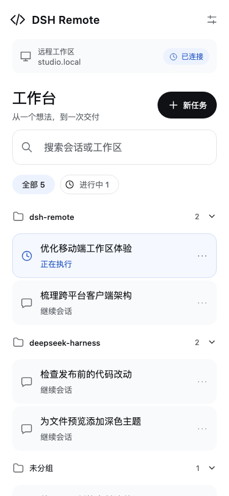
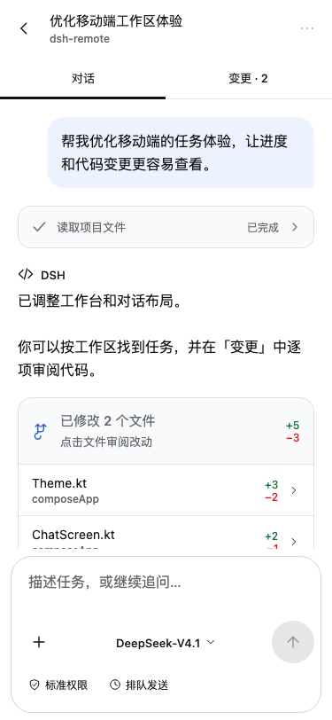

# DSH Remote

A self-hosted remote client for [DeepSeek Harness](https://github.com/deepseek-ai/deepseek-harness), built with Kotlin Multiplatform and Compose Multiplatform. Pair a phone with your own DSH instance, follow tasks, review changes, and respond to approvals.

```text
KMP client ── HTTPS / device cookie ──▶ relay ◀── outbound WSS ── DSH plugin
                                      Caddy + Node              local DSH
```

The DSH host needs no inbound port. You operate the relay; this repository does not include a hosted service, server address, or deployment credentials.

## Components

| Directory | Purpose |
|---|---|
| [`mobile/`](mobile/README.md) | Shared Compose UI, Android/iOS hosts, experimental HarmonyOS adapter |
| [`plugin/`](plugin/README.md) | DSH integration, outbound tunnel, pairing QR, device revocation |
| [`server/`](server/README.md) | Self-hosted relay, TLS, pairing, device authentication, streaming proxy |
| [`scripts/`](scripts/) | Publication checks and versioned artifact export |
| [`docs/`](docs/README.md) | Architecture, deployment, security, development and release guides |

The earlier standalone Android app has been retired. Android now runs the same shared UI as the other KMP targets.

## Client features

- Multiple paired instances with independent credentials and remembered selection.
- Task search, running filters, workspace groups, create/rename/fork/archive.
- Live conversation, code changes, tool results and deliverable cards.
- Approval and question dialogs, model/permission selection, queue/steer controls.
- Images/files, command/skill menus, file/session references and child sessions.
- Workspace files, terminal, background jobs and browser tools.
- Light/dark themes and adaptive phone/tablet layouts.

| Platform | Current support |
|---|---|
| Android | Primary runnable client; APK/AAB builds, QR pairing, file pickers and previews |
| iOS | SwiftUI host + shared Compose UI, Ktor transport and persistent instances; device signing and runtime verification depend on your Xcode setup |
| HarmonyOS NEXT | Shared code compiles and a DevEco host is included; networking and several platform services are still placeholders |
| JVM desktop | Development and offline verification host; credentials are kept in memory |

See [platform details](docs/cross-platform.md) for toolchain pins and limitations.

## Preview

These images render the production Compose components with **synthetic fixture data**. No live workspaces, pairing QR codes or server addresses are shown.

| Workbench | Conversation | Instance switcher |
|---|---|---|
|  |  |  |

## Quick start

### 1. Deploy your relay

Requirements: a Linux server, a domain you control, Docker Compose, and ports 80/443.

```sh
git clone https://github.com/journ10/dsh-remote-tunnel.git
cd dsh-remote-tunnel/server
sudo bash install.sh --domain example.com --email you@example.com
```

Replace the example values. Create DNS records for `relay.example.com` and `*.relay.example.com` pointing to your server. The installer generates local secrets, starts Caddy and the relay, and prints your plugin configuration. Follow [deployment](docs/deployment.md) for operations and multi-instance setup.

### 2. Connect the DSH plugin

Open **Plugins → Add plugin** in DSH, paste the URL below, install it, and choose
**Enable now**:

```text
https://github.com/journ10/dsh-remote-tunnel/releases/download/v0.36.0/dsh-remote-tunnel-0.2.0.tgz
```

Or install into your Web UI's profile from the CLI:

```sh
dsh plugin --profile web add https://github.com/journ10/dsh-remote-tunnel/releases/download/v0.36.0/dsh-remote-tunnel-0.2.0.tgz
```

Apply the configuration printed by the installer to the DSH profile, restart DSH, then open **Plugins → dsh-remote-tunnel → 服务器连接** to configure the instance token. The token is stored locally with restricted permissions. Generate a pairing QR when the tunnel is connected. See [plugin setup](plugin/README.md).

### 3. Install the KMP Android app

Download the signed APK from [GitHub Releases](https://github.com/journ10/dsh-remote-tunnel/releases/latest).
Android 8.0 (API 26) or later is required. The AAB is a distribution bundle, not
an APK you can install directly.

To build from source, install JDK 17 and Android SDK 35, then:

```sh
cd mobile
./gradlew :androidApp:assembleDebug
cd ..
python3 scripts/export_artifacts.py android --variant debug
adb install -r dist/0.36.0/android/dsh-remote-0.36.0-android-debug.apk
```

Scan the DSH plugin's QR code, or use its pairing link. On the workbench, tap the current-instance card to add, switch or remove instances. Existing KMP single-instance data migrates automatically.

## Build, test and release

```sh
# Node.js 24+ is suitable for both the plugin and relay.
npm ci --prefix server
pnpm --dir plugin install --frozen-lockfile
make test
make android
make release-android  # optional local release signing; see the release guide
```

`VERSION` defines the client/repository release version. Exported deliverables live only under `dist/<version>/<platform>/`, with `SHA256SUMS` and `manifest.json`; Gradle/Xcode intermediates stay in their native ignored build directories. Binaries are not committed to Git.

- [Development and live-test setup](docs/development.md)
- [Release paths and signing](docs/releases.md)
- [KMP UI and instance behavior](mobile/docs/ui-refresh.md)
- [Contributing](CONTRIBUTING.md)

## Security

The relay terminates TLS and can read proxied traffic. Run it on infrastructure you trust. Device cookies are checked against the relay's device registry, so revocation takes effect on subsequent requests. DSH's own session cookie stays on the DSH host and is injected by the plugin.

Real domains, IPs, tokens, private keys, signing material, runtime databases, local paths and live-test screenshots do not belong in source. `.env` and signing files are local; `.env.example` contains placeholders. Run `python3 scripts/audit_publication.py --staged` before committing. Automated checks complement manual review; they do not prove the absence of every possible secret.

Read the [security model](docs/security.md) and [report vulnerabilities privately](SECURITY.md).

## License

MIT. See [LICENSE](LICENSE).
