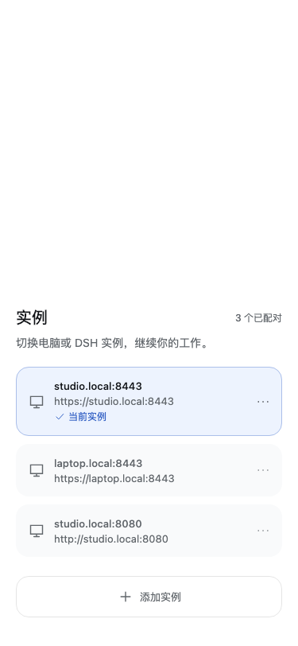

# KMP 多实例

KMP 现在恢复了原生 Android 的多实例流程：保存多个已配对实例、切换、
添加和移除。工作台顶部的「当前实例 · 点击切换」卡片和右上角管理按钮
都可以打开实例列表。

## 使用

1. 选择「添加实例」，扫描另一台电脑或 DSH 实例的二维码，也可以展开
   「使用配对链接」。配对成功后自动切换，原有实例继续保留。
2. 添加过程中可以「返回已有实例」。配对请求进行中会暂时禁用返回和重复提交。
3. 点击已配对实例即可切换，不需要再次扫码。切换后回到该实例的工作台。
4. 在实例右侧的更多菜单中选择「移除实例」并确认。移除当前实例时，
   自动选择剩余列表的第一个实例；移除最后一个实例后回到配对页。
5. 配对失效只会移除对应实例，不会清空其他实例。

## 存储与隔离

- Android 使用 SharedPreferences，iOS 使用 NSUserDefaults，持久化实例
  列表和上次选择。新注册表只存 origin，不保存一次性配对链接或 code。
- 原 KMP 的单实例记录及凭据首次启动自动迁移。同地址重新配对会更新凭据，
  不会增加重复条目；其他实例继续保留。
- 设备凭据按完整 origin（协议、域名、端口）存储。请求和 WebSocket 不会
  回退读取其他实例或旧的裸 host 凭据。移除只清理指定 origin 的凭据。
- 每次切换都会销毁旧实例的会话导航、弹窗、协程和事件连接，再创建新实例
  的状态。同一 origin 重新配对也会重建连接。旧回调不能操作新实例的审批。
- 原生 Android 应用与 KMP 使用不同的 application ID，系统不会共享应用
  私有存储。从原生 Android 首次转到 KMP 时，仍需在 KMP 中扫码配对。
- JVM 验证宿主继续使用内存存储；鸿蒙也接入了共享列表逻辑，但其网络适配
  仍是已有的占位实现，尚不能作为真实远程客户端使用。

## 验证（2026-10-20）

- 新增 10 项存储测试：旧记录迁移、已有新凭据保护、重启恢复、重复配对、
  移除非当前实例、移除当前/最后一个实例、彻底清空、异常数据、禁止恢复已
  移除旧记录、并发保存。
- 新增 3 项传输测试：同主机不同协议/端口的 HTTP 与事件流凭据隔离、
  一个实例过期不影响另一个、禁止请求复用旧 host 凭据。
- 新增真实 Compose 子树的 JVM 生命周期测试：切换、切回、同地址重新配对、
  退出均关闭旧事件流；旧关闭回调不重新启动已销毁的实例。
- 35 项共享测试、1 项生命周期测试通过。另有可选渲染测试生成 18 张图片，
  包括新增的实例列表浅色/深色、窄屏、横屏、大字体和添加配对页。
- Android debug/release 构建、iOS Simulator ARM64 和 OHOS ARM64 的共享
  Kotlin 编译通过。Android release 签名使用已有配置。
- 没有提供 `DSH_TEST_PAIR_URL`，17 项 live 测试没有执行实际联网验证。
  本轮没有两台真实 DSH 实例的端到端或手机扫码回归。
- Android release 的 lint 分析仍输出已有的 Kotlin 元数据版本不匹配诊断，
  构建成功不代表完整 lint 检查无问题。

导出安装包统一放在 `dist/<VERSION>/android/`，见[产物规范](../../docs/releases.md)。
离线渲染图片：`mobile/composeApp/build/reports/ui/`。
