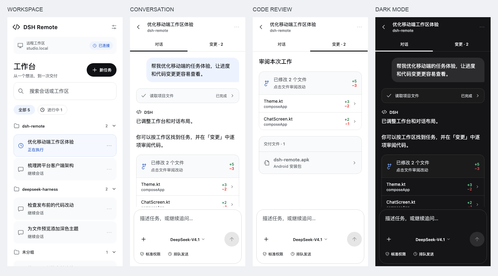

# KMP UI refresh

The shared Compose UI is organized around three decisions: choose the workspace,
follow the task, and inspect the result. This is the mobile interaction model
described in the [official Codex Remote guide](https://developers.openai.com/blog/mastering-codex-remote-for-engineering).
Visual references came from the locally running DeepSeek Harness interface:
white content, a quiet gray workspace surface, restrained blue accents, outline
icons, and bordered change/deliverable cards.



## Behavior

- Home provides all/running filters, workspace and title search, collapsible
  workspace groups, and explicit working-directory selection for new tasks.
  Counts use the same visible-session rules as the list. Workspace IDs identify
  groups even when their display names match. Search expands matching groups.
- Chat keeps the title readable and separates conversation from the changes
  view. File diffs and deliverables use the existing preview callbacks.
- The workspace tools sheet contains files, terminal, background jobs, browser,
  and child sessions. The browser starts with an address field.
- The composer contains attachments, references, commands, model selection,
  permissions, and queue/steer controls. In a short viewport, secondary controls
  move into the plus menu. Read-only child sessions cannot submit prompts.
- Tool results collapse by default. Assistant prose has an open layout; user
  messages retain the light blue bubble. Following live output does not
  intentionally scroll a reader who has moved away from the bottom.
- QR pairing remains the primary connection path, with manual links available
  through a secondary action. Loading, creation failure, and retry states are
  visible.
- The current-instance card opens a list of paired instances with switch, add,
  and remove actions. Adding an instance supports returning to the existing one.
  See [multi-instance storage and lifecycle details](multi-instance.md).

The remote endpoints are unchanged. This work reorganizes existing
DSH capabilities; it does not add Codex model access, worktree management, or
inline review comments.

## Shared components

`ui/Components.kt` owns the vector icons, status badges, empty/error states, and
tool actions. `ChatChrome.kt` owns the chat header, tabs, and adaptive composer.
`ChatCards.kt` owns messages, tool output, changes, and deliverables. `Theme.kt`
provides consistent light/dark colors and readable typography.

## Verification

Verified on 2026-10-20:

- 35 shared model/parser/transport tests and one JVM instance-lifecycle test
  passed. These include workspace identity/filter composition, instance
  persistence/migration, origin-scoped credentials, and socket cleanup on switch.
- The optional JVM render harness generated 18 images: 375 × 812 phone views,
  812 × 375 landscape views, a 1024 × 768 tablet view, light/dark appearances,
  a 320 × 568 instance list, and 1.5× font scaling. These render the production composables with sample
  data; they are not connected-device screenshots or end-to-end interaction tests.
- `:androidApp:assembleDebug`, `:androidApp:assembleRelease`,
  `:composeApp:compileKotlinIosSimulatorArm64`, and
  `:composeApp:compileKotlinOhosArm64` passed. The release APK uses the project's
  existing signing configuration; `apksigner verify` passed (v2 signature).
- Live relay tests were not exercised without `DSH_TEST_PAIR_URL`. Real-device
  pairing, keyboard/IME behavior, and live send/follow still need device regression.
  iOS and HarmonyOS validation here covers compilation, not signed app packages.
- Release assembly completes with the existing Kotlin metadata-version
  diagnostics in Android's lint analyzer; it is not a clean full lint validation.

With the build environment from `docs/cross-platform.md`, run from `mobile/`:

```bash
DSH_UI_CAPTURE_DIR="$PWD/composeApp/build/reports/ui" \
  ./gradlew :composeApp:jvmTest --rerun-tasks --no-configuration-cache

./gradlew :androidApp:assembleDebug \
  :composeApp:compileKotlinIosSimulatorArm64 \
  :composeApp:compileKotlinOhosArm64
```

Export APKs to `dist/<VERSION>/android/` using the repository
[release exporter](../../docs/releases.md). Gradle intermediates remain under
`androidApp/build/outputs/`.
The render harness is opt-in and does not connect to the user's workspace.
